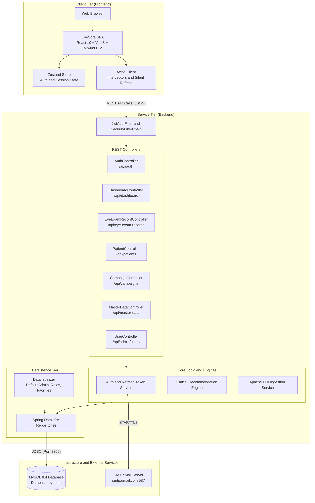
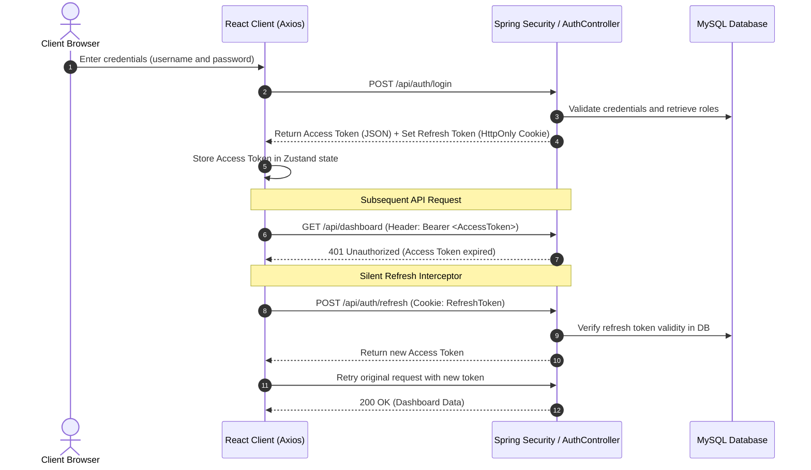
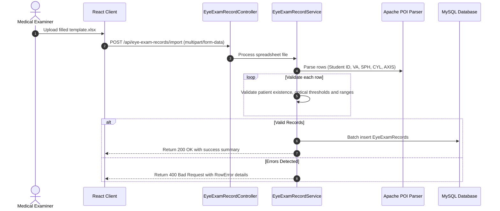

# EyeSora — School Vision & Refractive Error Screening Platform

[](https://adoptium.net/)
[](https://spring.io/projects/spring-boot)
[](https://react.dev/)
[](https://vitejs.dev/)
[](https://tailwindcss.com/)
[](https://www.mysql.com/)

EyeSora is an enterprise school health platform designed to digitize student vision screenings, track refractive errors (myopia, hyperopia, astigmatism), and deliver actionable clinical recommendations to educational administrators and public healthcare authorities.

---

## Table of Contents

- [1. Project Overview](#1-project-overview)
- [2. Key Features](#2-key-features)
- [3. System Architecture](#3-system-architecture)
- [4. Repository Structure](#4-repository-structure)
- [5. Technology Stack](#5-technology-stack)
- [6. Prerequisites](#6-prerequisites)
- [7. Getting Started](#7-getting-started)
- [8. Environment Configuration](#8-environment-configuration)
- [9. Database Setup](#9-database-setup)
- [10. Running the Application](#10-running-the-application)
- [11. Application Flows](#11-application-flows)
- [12. Service Endpoints](#12-service-endpoints)
- [13. API Documentation](#13-api-documentation)
- [14. Testing](#14-testing)
- [15. Docker & Containerization](#15-docker--containerization)
- [16. Deployment](#16-deployment)
- [17. Troubleshooting](#17-troubleshooting)
- [18. Project Documentation](#18-project-documentation)
- [19. License & Contributors](#19-license--contributors)

---

## 1. Project Overview

School-age vision impairments, particularly myopia, represent a growing pediatric health concern. Vision screening programs often encounter challenges with paper-based data collection, fragmented record management across schools, and an absence of automated clinical triage.

**EyeSora** solves this by providing:
- **Centralized Screening Management:** Organization of screening campaigns across schools, clinics, and administrative units (provinces, districts, wards).
- **Fast Examination Ingestion:** Support for direct online recording or bulk offline data intake through standard Excel spreadsheets.
- **Clinical Recommendation Engine:** Automated detection of severe myopia ($\le -6.00D$), significant astigmatism ($|CYL| \ge 1.50D$), borderline cases, and overdue re-examinations.
- **Actionable Visual Dashboards:** Role-tailored reporting offering city-wide epidemiological metrics for health authorities and class-level intervention insights for school administrators.

### Intended User Roles
1. **System Administrator (`ROLE_ADMIN`):** Healthcare officials and system managers responsible for managing facilities, campaigns, administrative units, system accounts, and city-wide epidemiological dashboards.
2. **Facility Administrator (`ROLE_FACILITY_ADMIN`):** School and clinic managers maintaining classes, student rosters, and reviewing institution-specific dashboards.
3. **Examiner (`ROLE_EXAMINER`):** Optometrists and medical field staff recording clinical eye measurements, importing examination spreadsheets, and inspecting individual patient histories.

---

## 2. Key Features

### Role-Based Access Control & Security
- Stateless JWT authentication with automatic silent token refresh via `HttpOnly` cookies.
- Email verification workflow and password reset tokens via SMTP.
- Role-scoped data isolation enforced at service and API boundary layers.

### Screening Campaign & Facility Management
- Multi-tier facility registry (Schools, Clinics, Hospitals) linked to administrative regions (Provinces, Wards).
- Campaign lifecycle tracking (`ACTIVE`, `LOCKED`) with target facility assignment and schedule monitoring.
- Class and student enrollment management structured by academic year and grade levels.

### Eye Examination & Clinical Records
- Granular optical parameter tracking:
  - Left & Right Visual Acuity (VA) without glasses and with glasses.
  - Sphere (SPH), Cylinder (CYL), and Axis (AXIS) measurements.
  - Examiner tracking and scheduled follow-up dates.
- High-throughput Excel workbook ingestion (`.xlsx`) with row-level error validation and progress reporting.
- Complete longitudinal refraction history per patient.

### Clinical Analytics & Recommendation Engine
- **City & Facility Dashboards:** Dynamic KPI counters, grade-wise myopia distribution, severity breakdowns, and comparative facility rankings.
- **Automated Clinical Alerting:** Automated categorization based on configurable clinical thresholds:
  - High astigmatism warnings ($|CYL| \ge 1.50D$).
  - High myopia alerts ($SPH \le -6.00D$).
  - Overdue re-examination alerts ($>30$ days past scheduled review).
- **Reporting:** Direct export of city-level epidemiological data to Excel workbooks.

---

## 3. System Architecture

EyeSora is built as a modular monorepo consisting of a React Single-Page Application (SPA) communicating over REST with a Spring Boot application backed by MySQL.



---

## 4. Repository Structure

```text
eyesora/
├── docker/
│   ├── docker-compose.yml          # Docker Compose defining MySQL 8.4 service
│   └── init.sql                    # MySQL initialization script
├── eyesora-be/                     # Backend API service (Java 17, Spring Boot 3)
│   ├── .env                        # Local backend environment variables (git-ignored)
│   ├── .env.example                # Template for backend environment variables
│   ├── Dockerfile                  # Production container definition for backend
│   ├── pom.xml                     # Maven dependencies and build configuration
│   ├── mvnw / mvnw.cmd             # Maven Wrapper scripts
│   ├── HELP.md                     # Spring Boot reference links
│   └── src/
│       ├── main/
│       │   ├── java/vn/edu/fpt/eyesora/  # Application source code
│       │   └── resources/
│       │       └── application.properties # Spring application properties
│       └── test/                   # Backend unit and integration test suites
├── eyesora-fe/                     # Frontend client (React 19, Vite, Tailwind CSS)
│   ├── Dockerfile                  # Container definition for frontend client
│   ├── package.json                # Frontend package dependencies & scripts
│   ├── package-lock.json           # Locked npm dependency tree
│   ├── vite.config.js              # Vite bundler configuration
│   ├── eslint.config.js            # ESLint rules and linter setup
│   ├── index.html                  # Single Page Application HTML root
│   ├── public/                     # Public static assets & Excel import templates
│   │   └── template.xlsx           # Official template for eye exam imports
│   └── src/                        # Modular React source code
│       ├── features/               # Feature-based domain modules
│       ├── shared/                 # Common components, layout, Axios client
│       ├── App.jsx                 # Application router and protected route guards
│       └── main.jsx                # Application DOM mounting point
├── DanhSachChucNang.xlsx           # Functional specification documentation
├── EyeSora_Huong_Dan_Su_Dung_Phan_Mem.docx # Vietnamese user instruction manual
├── change-author.sh                # Utility script
└── .gitignore                      # Monorepo version control ignore patterns
```

---

## 5. Technology Stack

### Frontend
| Technology | Version | Purpose |
|---|---|---|
| **React** | `^19.2.6` | Declarative UI rendering |
| **Vite** | `^8.0.12` | Development server and production bundling |
| **Tailwind CSS** | `^4.0.0` | Design styling and responsive utility classes |
| **Zustand** | `^5.0.14` | Global authentication and application state management |
| **Axios** | `^1.18.0` | HTTP communications and automated refresh token interceptor |
| **React Router DOM** | `^7.18.0` | Declarative client routing and role-based guards |
| **Lucide React** / **Heroicons** | `^1.21.0` / `^2.2.0` | System icon pack |
| **jwt-decode** | `^4.0.0` | In-browser JWT claims decoding |
| **ESLint** | `^10.3.0` | Static linting and code quality analysis |

### Backend
| Technology | Version | Purpose |
|---|---|---|
| **Java** | `17` | Execution runtime |
| **Spring Boot** | `3.5.14` | Enterprise service framework |
| **Spring Data JPA** | 3.5.14 Starter | Hibernate-based ORM and persistence abstraction |
| **Spring Security** | 3.5.14 Starter | RBAC security filter chain and password encoding |
| **JJWT (Java JWT)** | `0.12.6` | Access token generation and verification |
| **Apache POI** | `5.2.5` | Excel (.xlsx) file processing for batch imports and data export |
| **SpringDoc OpenAPI** | `2.8.16` | OpenAPI 3.0 specification and Swagger UI |
| **Dotenv Java** | `3.0.0` | `.env` file parsing for local runtime configuration |
| **Jakarta Validation** | `3.1.0` | Model and DTO request validation |
| **Lombok** | 1.18.x | Code generation for constructors, getters, and setters |
| **JUnit 5 & Mockito** | 3.5.14 Starter | Automated unit and mock testing |

### Database & DevOps
| Technology | Version | Purpose |
|---|---|---|
| **MySQL** | `8.4` | Relational database engine |
| **Docker & Docker Compose** | v3+ Spec | Local infrastructure containerization |

---

## 6. Prerequisites

Ensure your workstation meets the following requirements before setting up EyeSora:

- **Git:** `2.38+` ([Download Git](https://git-scm.com/))
- **Java Development Kit (JDK):** Version `17` ([Eclipse Temurin Recommended](https://adoptium.net/))
- **Node.js:** Version `20.x` or higher ([Node.js Official](https://nodejs.org/))
- **Package Manager:** `npm` (included with Node.js)
- **Docker Engine & Docker Compose:** ([Docker Desktop](https://www.docker.com/products/docker-desktop/))
- **MySQL Client / GUI (Optional):** MySQL Workbench, DBeaver, or DataGrip

---

## 7. Getting Started

### Step 1 – Clone Repository

```bash
git clone git@github.com:chao-dau-999/eyesora.git
cd eyesora
```

### Step 2 – Configure Local Environment Files

#### Backend Configuration
Copy the provided environment template into `eyesora-be/.env`:

```bash
cp eyesora-be/.env.example eyesora-be/.env
```

Edit `eyesora-be/.env` with your local database and mail settings:

```env
DB_USERNAME=root
DB_PASSWORD=root
DB_URL=jdbc:mysql://localhost:3306/eyesora?useUnicode=true&characterEncoding=UTF-8

JWT_SECRET_KEY=VGhpczFzU2VjcmV0S2V5K1RoaXMxc1NlY3JldEtleStUaGlzMXNTZWNyZXRLZXk=
JWT_ACCESS_EXPIRES_IN=3600000
JWT_REFRESH_EXPIRES_IN=7

MAIL_USERNAME=your_email@gmail.com
MAIL_PASSWORD=your_app_password
```

> [!NOTE]
> `JWT_SECRET_KEY` must be a valid Base64-encoded string of at least 256 bits (32 bytes).

#### Frontend Configuration (Optional)
By default, the frontend connects to `http://localhost:8080/api`. If you wish to customize it:

```bash
# In eyesora-fe/
echo "VITE_API_URL=http://localhost:8080/api" > eyesora-fe/.env
```

### Step 3 – Start the MySQL Database

Using Docker Compose:

```bash
cd docker
docker compose up -d
cd ..
```

Verify that the MySQL container is running on port `3306`:

```bash
docker compose -f docker/docker-compose.yml ps
```

### Step 4 – Install Frontend Dependencies

```bash
cd eyesora-fe
npm install
cd ..
```

---

## 8. Environment Configuration

### Backend Variables (`eyesora-be/.env` or OS Environment)

| Variable | Description | Required | Default / Sample |
|---|---|---|---|
| `DB_URL` | JDBC connection string | **Yes** | `jdbc:mysql://localhost:3306/eyesora?useUnicode=true&characterEncoding=UTF-8` |
| `DB_USERNAME` | MySQL database username | **Yes** | `root` |
| `DB_PASSWORD` | MySQL database password | **Yes** | `root` |
| `JWT_SECRET_KEY` | Base64-encoded HMAC-SHA secret key | **Yes** | *(Base64 string $\ge 256$ bits)* |
| `JWT_ACCESS_EXPIRES_IN` | Access token lifespan in milliseconds | **Yes** | `3600000` (1 hour) |
| `JWT_REFRESH_EXPIRES_IN` | Refresh token duration in days | **Yes** | `7` |
| `MAIL_USERNAME` | SMTP server sender email | Optional | `your_email@gmail.com` |
| `MAIL_PASSWORD` | SMTP app-specific password | Optional | `app_password` |
| `app.cors.allowed-origins` | Permitted CORS origins | No | `http://localhost:5173` |

### Frontend Variables (`eyesora-fe/.env`)

| Variable | Description | Required | Default |
|---|---|---|---|
| `VITE_API_URL` | Base endpoint for backend API | No | `http://localhost:8080/api` |

---

## 9. Database Setup

The backend uses **Spring Data JPA** with Hibernate schema management configured in `application.properties`:
```properties
spring.jpa.properties.hibernate.hbm2ddl.auto=update
```

When the backend boots against an empty `eyesora` database, Hibernate automatically generates all relational tables, indexes, and foreign keys.

### Automated Seed Data (`DataInitializer.java`)
On startup, `DataInitializer.java` detects if user and organizational records exist. If empty, it automatically provisions:
1. **Roles:** `ADMIN`, `FACILITY_ADMIN`, `EXAMINER`
2. **Default Users (Password: `password`):**
   - `admin` (`admin12345@gmail.com`) — System Administrator
   - `owner1` (`owner1@gmail.com`) — School Administrator (Facility 1)
   - `examiner` (`examiner@gmail.com`) — Clinical Examiner
3. **Default Facilities:** "THCS Lê Hồng Phong", "THCS Dương Kỳ Hiệp"
4. **Administrative Hierarchy:** Province "Thành phố Cần Thơ" with Wards "Phú Lợi", "Sóc Trăng", "Mỹ Xuyên"
5. **Screening Campaign:** "THCS Duong Ki Hiep - 13/04/2026"

---

## 10. Running the Application

### Execution Order
1. **Database:** Start MySQL service.
2. **Backend:** Launch Spring Boot API.
3. **Frontend:** Launch Vite dev server.

### 1. Start Database
```bash
cd docker
docker compose up -d
cd ..
```

### 2. Start Backend (`eyesora-be`)
From the monorepo root:
```bash
cd eyesora-be
./mvnw spring-boot:run
```
*The backend starts at `http://localhost:8080`.*

### 3. Start Frontend (`eyesora-fe`)
In a separate terminal window:
```bash
cd eyesora-fe
npm run dev
```
*The frontend development server starts at `http://localhost:5173`.*

---

## 11. Application Flows

### 1. Authentication and Silent Token Refresh
The system uses access tokens in application memory with refresh tokens stored in secure, `HttpOnly` cookies.



### 2. Bulk Examination Ingestion via Excel
Field staff upload standardized spreadsheets containing screening records for entire school classes.



---

## 12. Service Endpoints

| Service / Component | Port | Base URL / Access | Description |
|---|---|---|---|
| **Frontend Application** | `5173` | `http://localhost:5173` | React SPA User Interface |
| **Backend API** | `8080` | `http://localhost:8080/api` | Spring Boot REST API |
| **OpenAPI Specification** | `8080` | `http://localhost:8080/v3/api-docs` | OpenAPI 3.0 JSON specification |
| **Swagger UI** | `8080` | `http://localhost:8080/swagger-ui/index.html` | Interactive API documentation |
| **MySQL Database** | `3306` | `localhost:3306` | Relational database instance |

### Core REST Controller Mappings
- **Authentication:** `/api/auth` (Login, Register, Refresh, Verify, Forgot/Reset Password, Me)
- **City Dashboard:** `/api/dashboard` (Counters, Grade stats, Timeline, Analysis, Critical Alerts, Export)
- **Facility Dashboard:** `/api/dashboard/facility` (List, Grade stats, Facility summaries, Alert records)
- **Screening Campaigns:** `/api/campaigns` (CRUD, status transitions)
- **Exam Records:** `/api/eye-exam-records` (CRUD, patient histories, Excel batch import)
- **Patient Management:** `/api/patients` (CRUD, overdue re-examinations tracking)
- **Master Data:** `/api/master-data` (Provinces, Wards, Facilities, Classes)
- **User Administration:** `/api/admin/users` (User lifecycle and status management)

---

## 13. API Documentation

Interactive API documentation is generated via SpringDoc OpenAPI:

- **Swagger UI Console:** [http://localhost:8080/swagger-ui/index.html](http://localhost:8080/swagger-ui/index.html)
- **OpenAPI Schema (JSON):** [http://localhost:8080/v3/api-docs](http://localhost:8080/v3/api-docs)

To test secured endpoints inside Swagger UI:
1. Execute `POST /api/auth/login` using default credentials (`admin` / `password`).
2. Copy the `accessToken` from the response.
3. Click the **Authorize** button at the top of Swagger UI and enter: `Bearer <your_token>`.

---

## 14. Testing

### Backend Automated Tests
Backend testing uses JUnit 5 and Mockito. Test classes are located in `eyesora-be/src/test/java/`.

Execute backend tests via Maven Wrapper:
```bash
cd eyesora-be
./mvnw test
```

### Frontend Testing
Automated frontend testing is not currently configured in `eyesora-fe/package.json`. Static analysis and linting can be run via:
```bash
cd eyesora-fe
npm run lint
```

---

## 15. Docker & Containerization

The repository includes a ready-to-use Docker orchestration stack (`docker/docker-compose.yml`) containing MySQL 8.4, the Spring Boot backend (`eyesora-be`), and the React SPA frontend (`eyesora-fe`).

### Running the Full Monorepo Stack with Docker Compose

From the monorepo root:

```bash
# Build and start all services in detached mode
docker compose -f docker/docker-compose.yml up --build -d

# Check running container statuses
docker compose -f docker/docker-compose.yml ps

# Follow logs for all services (or specify: mysql, eyesora-be, eyesora-fe)
docker compose -f docker/docker-compose.yml logs -f

# Shut down all containers and networks
docker compose -f docker/docker-compose.yml down
```

Once started:
- **Frontend UI:** [http://localhost:5173](http://localhost:5173)
- **Backend API:** [http://localhost:8080/api](http://localhost:8080/api)
- **Swagger UI:** [http://localhost:8080/swagger-ui/index.html](http://localhost:8080/swagger-ui/index.html)
- **MySQL Database:** `localhost:3306` (Database: `eyesora`, Username: `root`, Password: `root`)

### Individual Container Builds

#### Build & Run Backend Image:
```bash
docker build -t eyesora-be:latest ./eyesora-be
```

#### Build & Run Frontend Image:
```bash
docker build -t eyesora-fe:latest ./eyesora-fe
```

---

## 16. Deployment

### Production Build

#### 1. Build Backend Executable JAR:
```bash
cd eyesora-be
./mvnw clean package -DskipTests
# Resulting artifact: target/eyesora-0.0.1-SNAPSHOT.jar
```

Execute the built JAR in production:
```bash
java -jar -Dspring.profiles.active=prod target/eyesora-0.0.1-SNAPSHOT.jar
```

#### 2. Build Frontend Static Assets:
```bash
cd eyesora-fe
npm run build
# Resulting bundle: eyesora-fe/dist/
```
The static files in `eyesora-fe/dist/` can be served using Nginx, Apache HTTP Server, or any static hosting service.

---

## 17. Troubleshooting

| Symptom | Probable Cause | Recommended Action |
|---|---|---|
| **Database Connection Refused** (`Connection to localhost:3306 refused`) | MySQL container is stopped or port `3306` is unmapped. | Run `docker compose -f docker/docker-compose.yml up -d` and check `docker ps`. |
| **`Access denied for user 'root'@'...'`** | Incorrect `DB_PASSWORD` or `DB_USERNAME`. | Verify that values in `eyesora-be/.env` match the MySQL configuration in `docker/docker-compose.yml`. |
| **Dotenv / Configuration Failure** | Missing `.env` in `eyesora-be/`. | Copy `eyesora-be/.env.example` to `eyesora-be/.env` and verify variable names. |
| **CORS Errors in Browser Console** | Frontend origin does not match backend CORS policy. | Confirm backend property `app.cors.allowed-origins` allows `http://localhost:5173`. |
| **Silent Refresh Fails (Infinite Login Redirect)** | Refresh token cookie expired, revoked, or blocked by browser cookie policies. | Verify browser allows credentials across origins (`withCredentials: true`), clear cookies, and re-login. |
| **Port Collision (`Port 8080 / 5173 already in use`)** | Another process is occupying the default port. | Terminate the occupying process or change `server.port` in `application.properties` or `--port` in Vite. |

---

## 18. Project Documentation

Additional documentation and resources stored in the repository:

- [User Guide (Vietnamese)](EyeSora_Huong_Dan_Su_Dung_Phan_Mem.docx) — Detailed end-user manual for clinical staff and operators.
- [Feature Checklist](DanhSachChucNang.xlsx) — Excel breakdown of system requirements and use cases.
- [Excel Import Template](eyesora-fe/public/template.xlsx) — Standard workbook structure for importing eye examination records.
- [Frontend README](eyesora-fe/README.md) — Frontend overview and script references.
- [Spring Boot Reference Guide](eyesora-be/HELP.md) — Backend reference documentation and guides.

---

## 19. License & Contributors

- **Organization:** FPT University Software Project (`vn.edu.fpt.eyesora`)
- **Maintained By:** Project Development Team
- **Internal Reference:** [EyeSora Repository](https://github.com/chao-dau-999/eyesora)
